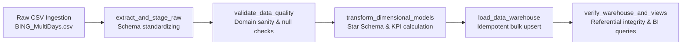

# Advertising Performance ETL Pipeline & Data Warehouse

Author: **sk03167**

Production-grade, idempotent ETL pipeline orchestrating advertising performance data (`BING_MultiDays.csv`) into a Star Schema Data Warehouse using **Apache Airflow**, **Python**, **SQLAlchemy**, and **PostgreSQL**.

---

## 🏗️ Architecture & Pipeline Flow

The pipeline follows a modular **Extract-Validate-Transform-Load (E-V-T-L)** architecture:



---

## 📊 Data Modeling & Star Schema

The warehouse schema is designed around a **Star Schema** optimized for high-performance aggregation, downstream BI tools, and automated **AI Insights Agents** (Text-to-SQL and anomaly detectors).

```
                        ┌──────────────────┐
                        │   dim_account    │
                        ├──────────────────┤
                        │ *account_id (PK) │
                        │  customer_id     │
                        │  account_number  │
                        │  account_name    │
                        │  account_status  │
                        │  currency_code   │
                        └────────┬─────────┘
                                 │
┌──────────────────┐             │             ┌──────────────────┐
│   dim_campaign   │             │             │   dim_ad_group   │
├──────────────────┤             │             ├──────────────────┤
│ *campaign_id(PK) │             │             │ *ad_group_id(PK) │
│  account_id (FK) │             │             │  campaign_id(FK) │
│  campaign_name   │             │             │  ad_group_name   │
│  campaign_status │             │             │  ad_group_status │
└────────┬─────────┘             │             └────────┬─────────┘
         │                       │                      │
         │          ┌────────────┴─────────────┐        │
         └─────────►│fact_ad_performance_daily │◄───────┘
                    ├──────────────────────────┤
                    │ *performance_id (PK Hash)│
                    │  date_id (FK)            │
                    │  account_id (FK)         │
                    │  campaign_id (FK)        │
                    │  ad_group_id (FK)        │
                    │  ad_id (FK)              │
                    │ ──────────────────────── │
                    │  device_type / OS        │
                    │  network / language      │
                    │  match types / placement │
                    │ ──────────────────────── │
                    │  impressions             │
                    │  clicks                  │
                    │  spend                   │
                    │  avg_position            │
                    │  conversions             │
                    │  assists                 │
                    │ ──────────────────────── │
                    │  ctr, cpc, cpa, conv_rate│
                    └────────────┬─────────────┘
                                 │
┌──────────────────┐             │             ┌──────────────────┐
│      dim_ad      │◄────────────┴────────────►│     dim_date     │
├──────────────────┤                           ├──────────────────┤
│ *ad_id (PK)      │                           │ *date_id (PK)    │
│  ad_group_id(FK) │                           │  full_date       │
│  ad_title        │                           │  day, month, year│
│  ad_description  │                           │  quarter         │
│  ad_type         │                           │  day_name        │
│  urls & tracking │                           │  is_weekend      │
└──────────────────┘                           └──────────────────┘
```

### Strategic Modeling Choices:
1. **Surrogate & Clean Keys**:
   - `ad_id` and `ad_group_id`: Stripped raw bracket artifacts (e.g., `[6772783690]` &rarr; `6772783690`) into 64-bit BigInts for query performance.
   - `campaign_id`: Generated deterministic hash from `account_id + campaign_name` to prevent collisions across different advertiser accounts.
   - `performance_id`: Deterministic hash of the fact grain `(date, ad_id, device, network, match_type)` ensuring 100% idempotent warehouse loads.
2. **Degenerate Dimensions on Fact**:
   - Targeting attributes (`device_type`, `device_os`, `network`, `top_vs_other`, `delivered_match_type`) are stored directly on the fact table to eliminate expensive joins during multi-dimensional ad slicing.
3. **Automated Insights Agent Enablement**:
   - Pre-computed KPIs (`ctr`, `cpc`, `cpa`, `conversion_rate`) are derived with zero-division protection at load time. This prevents Text-to-SQL or AI agents from generating inaccurate divide-by-zero queries.
   - Includes prepared analytical views (`vw_campaign_leaderboard`, `vw_ad_performance_summary`) for instant consumption by BI dashboards and automated anomaly agents.

---

## 🛠️ Project Structure

```text
advertising_airflow_pipeline/
├── dags/
│   └── bing_ads_etl_dag.py        # Airflow DAG definition & task orchestration
├── src/
│   ├── config.py                  # Environment settings & file paths
│   ├── run_pipeline.py            # Standalone pipeline CLI runner (<1s execution)
│   ├── db/
│   │   ├── connection.py          # SQLAlchemy engine & session management
│   │   └── models.py              # Star schema dimensional ORM models & DDL
│   └── pipeline/
│       ├── extract.py             # CSV ingestion & column standardization
│       ├── validate.py            # Data quality checks & anomaly detection
│       ├── transform.py           # Star Schema transformations & KPI logic
│       └── load.py                # Idempotent warehouse loading & view creation
├── tests/
│   └── test_pipeline.py           # Automated pytest test suite
├── data/
│   └── input/
│       └── BING_MultiDays.csv     # Raw advertising performance dataset
├── docker-compose.yml             # Full Airflow + PostgreSQL stack
├── Dockerfile                     # Custom Airflow image with Python requirements
├── requirements.txt               # Pinned Python dependencies
└── README.md                      # Project documentation
```

---

## 🚀 How to Run

You have two convenient ways to run and evaluate this pipeline:

### Option 1: Standalone Instant Runner (Fastest & Zero Setup)
Run the entire pipeline end-to-end directly in your Python environment:

```bash
# 1. Activate virtual environment
# Windows: .\.venv\Scripts\Activate.ps1
# Mac/Linux: source .venv/bin/activate

# 2. Run the pipeline (executes E-V-T-L in <1 second)
python src/run_pipeline.py
```
> *Note: If a live PostgreSQL instance is not detected, it automatically and gracefully loads into a local SQLite warehouse (`data/warehouse.db`) and queries the analytical leaderboard view.*

---

### Option 2: Apache Airflow via Docker Compose (Production Deployment)

To run the complete Apache Airflow orchestration stack with PostgreSQL:

```bash
# 1. Build and launch Airflow + PostgreSQL
docker-compose up -d

# 2. Access the Airflow Web UI
# Open http://localhost:8080 in your browser
# Default Credentials:
#   Username: airflow
#   Password: airflow
```

The DAG `bing_advertising_performance_pipeline` will be unpaused and scheduled. Trigger it from the UI or via CLI:
```bash
docker-compose exec airflow-webserver airflow dags trigger bing_advertising_performance_pipeline
```

---

## 🧪 Automated Testing

Run the test suite covering data quality assertions, ID cleaning, KPI math, referential integrity, and idempotency:

```bash
pytest tests/ -v
```

Test Results:
```text
tests/test_pipeline.py::test_clean_id PASSED                             [ 16%]
tests/test_pipeline.py::test_generate_surrogate_key PASSED               [ 33%]
tests/test_pipeline.py::test_validation_flags_negative_metrics PASSED    [ 50%]
tests/test_pipeline.py::test_validation_detects_click_anomalies PASSED   [ 66%]
tests/test_pipeline.py::test_kpi_calculations PASSED                     [ 83%]
tests/test_pipeline.py::test_referential_integrity_and_idempotency PASSED [100%]
============================== 6 passed in 1.93s ==============================
```

---

## 🔍 Edge Cases & Domain Anomalies Handled

1. **Ad-Tech Attribution Latency / Repeat Clicks**:
   - The validation engine detected **11 rows where `clicks > impressions`** in the dataset.
   - In digital advertising, this occurs when users click an ad multiple times from a single impression or when cross-day attribution cutoffs delay impression logging.
   - Rather than dropping valid spend data, the pipeline flags the anomaly in the audit report while preserving financial integrity.
2. **Missing Positions on Zero-Impression Ads**:
   - Handled `avg_position = NaN` gracefully when impressions equal zero.
3. **Idempotent Ingestion**:
   - The warehouse loader employs `ON CONFLICT DO NOTHING` / deterministic hashing. Re-running the DAG or script multiple times will never duplicate rows or cause primary key violations.
